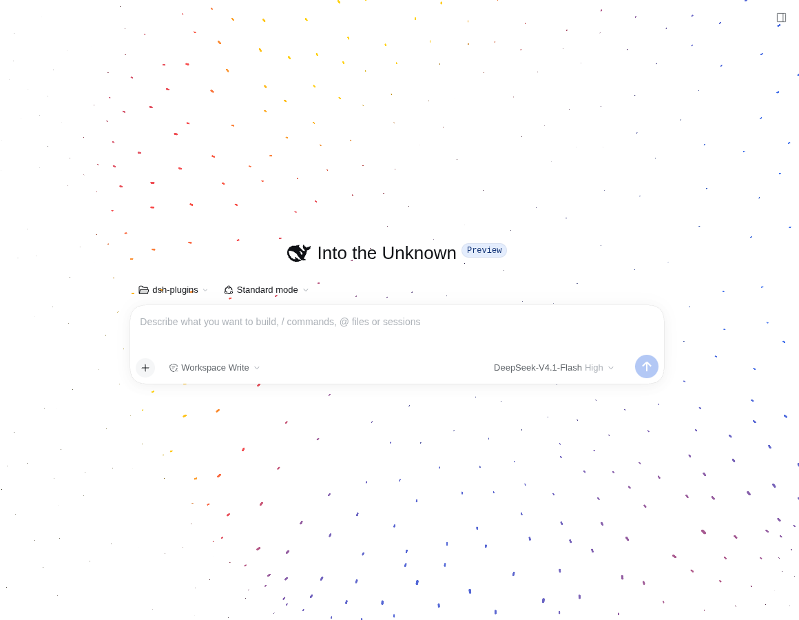
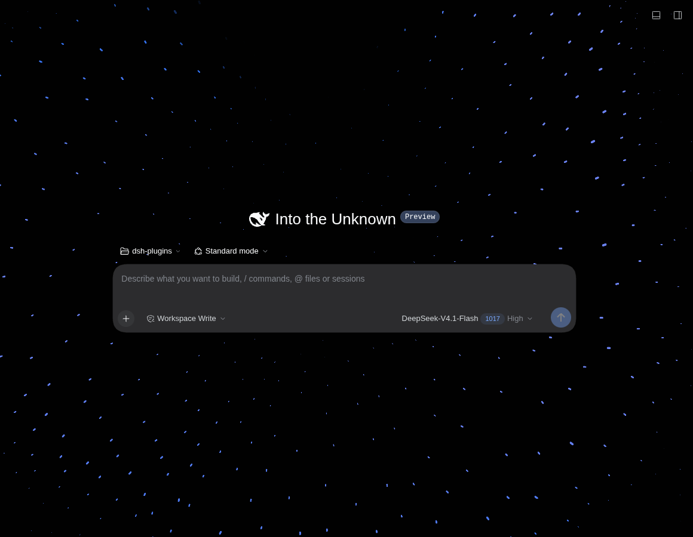
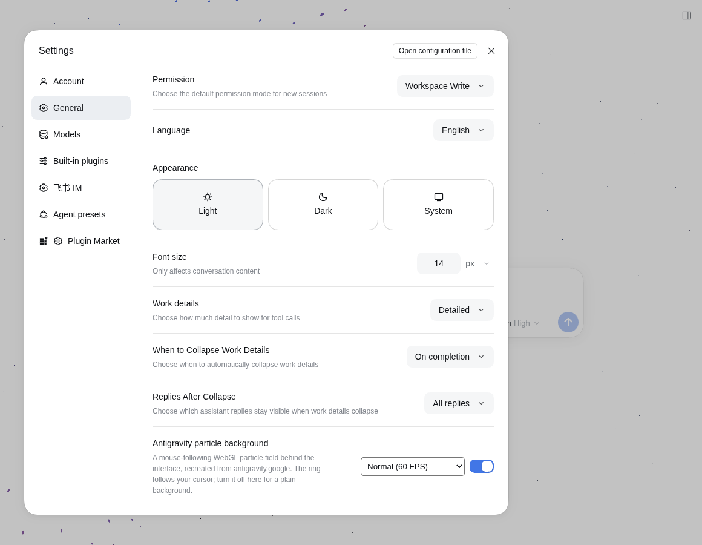

# dsh-plugin-agy-bg

A [DeepSeek Harness](https://github.com/deepseek-ai/deepseek-harness) Web UI plugin that paints the **mouse-following WebGL particle background** from [antigravity.google](https://antigravity.google/) behind the interface.

- The shell's full-page surfaces become transparent so the particle field shows through the workspace, while the sidebar, composer, cards and dialogs keep their own backgrounds.
- The particle ring follows the cursor with easing, a breathing radius, ring-band displacement and slow idle drift.
- Light and dark palettes follow the Harness theme automatically.
- On/off switch in **Settings → General** (default on, remembered per browser).
- Plain WebGL2, no three.js: a 256×256 GPU ping-pong particle simulation plus point-sprite rendering.

## Screenshots

Light theme (new session):



Dark theme:



The switch in Settings → General:



## Requirements

- DeepSeek Harness `0.2.1-rc.2` – `0.2.x` with the Web UI profile.
- A browser with **WebGL2** plus `EXT_color_buffer_float` (recent desktop browsers). Without it the plugin stays completely inert and the UI remains unchanged.

## Install

### Plugins UI

Sidebar → **Plugins → Add plugin**, enter this package directory (or an npm/git spec), then **Enable now**. Refresh the Web UI once.

### CLI

```sh
# 1) install as a link: dependency into the web profile
dsh plugin --profile web add link:/path/to/dsh-plugin-agy-bg

# 2) the plugin is usually added to the bundle list automatically; if not, add it to
#    ~/.dsh/profiles/web/package.json → dsh.profile.bundles (after dsh-base / dsh-web-app)
```

The web profile's HMR recomposes on profile manifest changes, so no `dsh.service` restart is needed; refresh the page once to load the new client graph.

Uninstall by removing the dependency and the bundle entry (or use the Plugins page).

## Usage

- **Settings → General → “Antigravity particle background”** toggles the background instantly. The preference is stored in `localStorage` under `dsh-plugin-agy-bg:v1`.
- With `prefers-reduced-motion: reduce`, the plugin caps density at 110 and simulates every other frame, matching the original site's behavior.
- If WebGL2 or float render targets are unavailable, nothing is changed visually.

## How it works

- **Particle simulation** — a 256×256 `RGBA32F` texture pair is ping-ponged every frame; the fragment shader updates each particle's position, scale and velocity, and point sprites read the simulation texture when drawing.
- **Parameters** — the same values as the antigravity.google hero: `density 230`, `ringWidth 0.006`, `ringWidth2 0.107`, `ringDisplacement 0.62`, `particlesScale 0.59`, colors `#2c64ed / #f84242 / #ffcf03`. Dark theme uses the palette/parameters of the site's footer CTA.
- **Cursor mapping** — the pointer is mapped onto the z=0 plane and multiplied by `0.175` to get the ring center; the ring eases toward it at 0.02/frame and its radius breathes with `0.175 + sin(t)·0.03 + cos(3t)·0.02`.
- **Transparency strategy** — only containers that cover the full page height and use the theme base color are tagged `data-dsh-antigravity-surface="transparent"` (the shell frame plus the large center surfaces). The composer, code blocks, cards and dialogs keep their own fills. The scan repeats every 2 s so client-side navigation is handled.
- **Composer fade & status-bar veil** — DSH paints a ~36 px `composerSeat` gradient above the composer; while the plugin is active that gradient is removed so particles reach the input edge. A fixed canvas, exactly as wide as the composer card, re-paints the particle field over the band below and behind the card (`#dsh-antigravity-veil`): the transcript scrolling underneath is covered while the visible background stays the live particle field. Turning the plugin off restores both.
- **Switch** — a React row registered into `settings.general.item`, with English/Chinese copy registered through the plugin locale namespace.

## Development

```
client.js        built browser artifact (also the file watched by client HMR)
index.js         host half — intentionally empty
src/
  engine.part.js   particle engine extracted from the standalone recreation
  plugin.part.js   shell integration, theme/surface handling, Settings row
  noise.glsl       Ashima Arts simplex noise
build.mjs        src/* → client.js
cordis.patch.yml inserts this plugin's Loader row
```

```sh
node build.mjs     # rebuild client.js
npm run check      # node --check client.js && node --check index.js
```

Editing `client.js` (or rebuilding it from `src/`) hot-swaps the plugin in an open Web UI; editing the host half requires a profile recomposition.

## License

MIT. This is an unofficial interaction recreation, not affiliated with Google; the visual parameters were observed from the public antigravity.google page.

[中文说明](README.zh.md)
