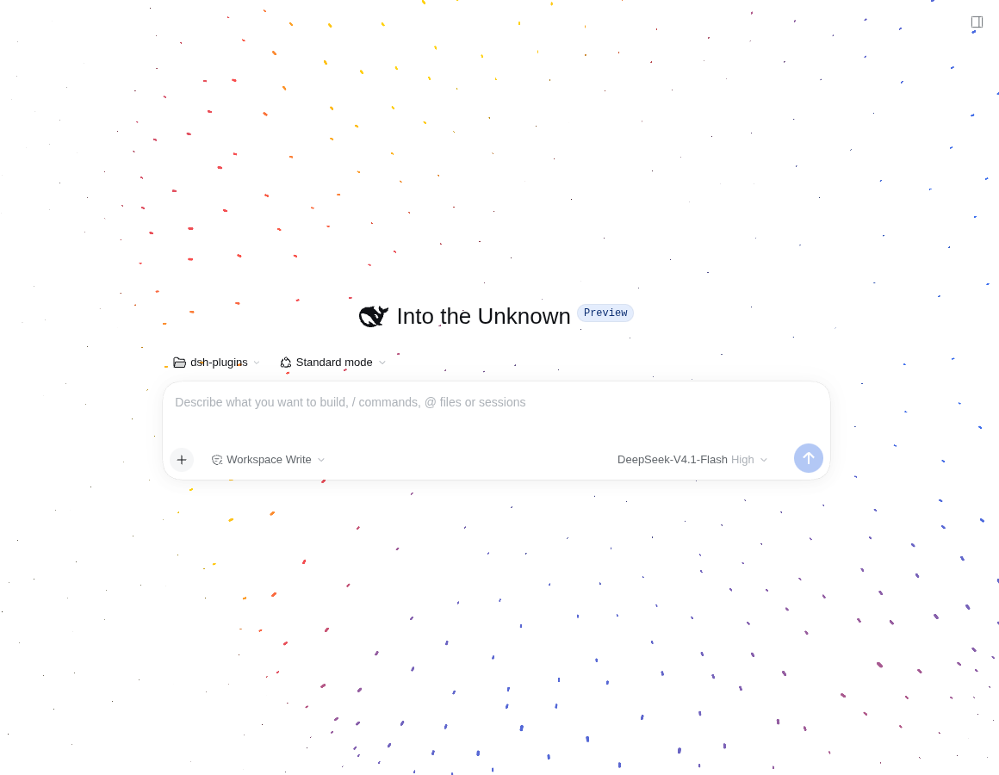
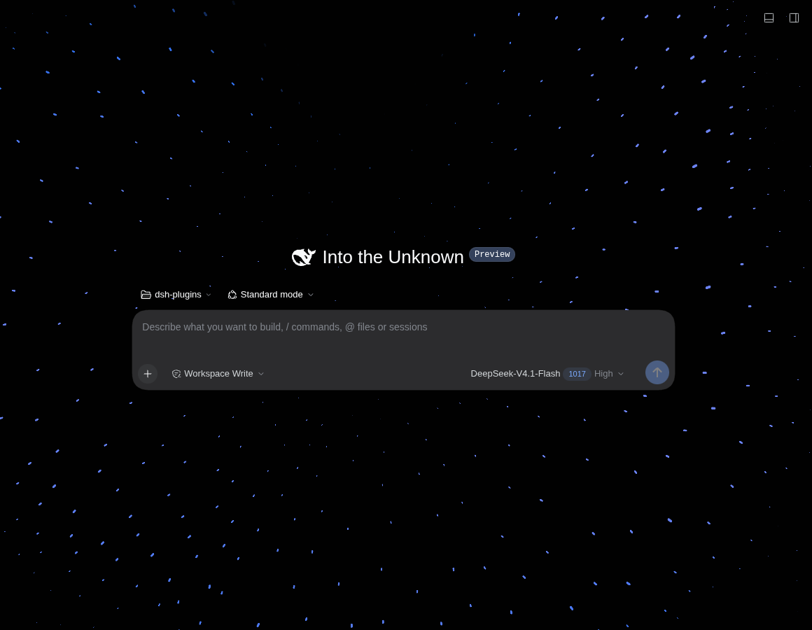
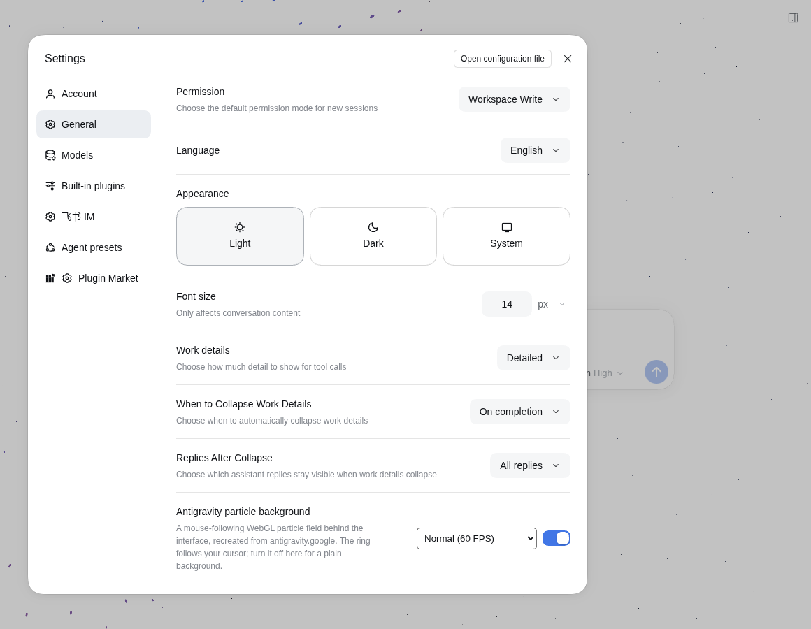

# dsh-plugin-agy-bg

DeepSeek Harness Web UI 插件：把 [antigravity.google](https://antigravity.google/) 首页那层**跟随鼠标的 WebGL 粒子背景**铺到 Harness 界面背后。

- 透明化 shell 的整页底色与主内容区大表面，让粒子场从工作区背后透出来；侧栏、输入框、卡片、弹窗仍保留自己的背景。
- 粒子环跟随光标移动，带缓动、呼吸半径、环带位移与低速漂移。
- 自动跟随 Harness 的浅色 / 深色主题切换配色。
- Settings → General 里有一个开关（默认开启，偏好存在浏览器 `localStorage`）。
- 单文件浏览器端实现：不引入 three.js，原生 WebGL2 + GPU ping-pong 模拟。

## 效果

浅色主题（新会话页）：



深色主题：



Settings → General 里的开关：



## 环境要求

- DeepSeek Harness `0.2.1-rc.2` – `0.2.x`，Web UI profile。
- 支持 **WebGL2** + `EXT_color_buffer_float` 的浏览器（近几年的桌面浏览器）。不支持时插件完全不生效，界面保持原样。

## 安装

### 插件管理器

Sidebar → **Plugins → Add plugin**，填 npm 包名 `dsh-plugin-agy-bg`（或本包目录），然后 **Enable now**。安装后刷新一次 Web UI。

### CLI

```sh
# 1) 以 link: 依赖装进 web profile
dsh plugin --profile web add dsh-plugin-agy-bg   # 本地目录用 link:/path/to/dsh-plugin-agy-bg

# 2) 通常会自动加进 bundles；如果没有，手动加到
#    ~/.dsh/profiles/web/package.json → dsh.profile.bundles（dsh-base / dsh-web-app 之后）
```

web profile 的 HMR 会监听 profile manifest，重组合后刷新页面即可看到效果（不用重启 `dsh.service`）。

卸载：从 `dependencies` 与 `dsh.profile.bundles` 里移除后 `pnpm install`，或直接用插件管理器移除。

## 使用

- 打开 **Settings → General**，找到「Antigravity 粒子背景」一行，用右侧开关即时开/关；偏好按浏览器保存在 `localStorage` 的 `dsh-plugin-agy-bg:v1`。
- 浏览器不支持 WebGL2 / 浮点渲染目标时，插件会安静地保持原界面（不会做透明化处理）。
- 系统开启「减少动态效果」时自动把粒子密度降到 ≤110 并隔帧模拟，和官网行为一致。

## 实现要点

- **粒子模拟**：256×256 RGBA32F 纹理 ping-pong，每帧由 fragment shader 更新位置、缩放、速度；点精灵渲染时读取模拟纹理。
- **参数**：与官网 Hero 相同（`density 230`、`ringWidth 0.006`、`ringWidth2 0.107`、`ringDisplacement 0.62`、`particlesScale 0.59`；配色 `#2c64ed / #f84242 / #ffcf03`）。深色使用官网底部 CTA 的配色与参数。
- **跟随逻辑**：光标映射到 z=0 平面后乘 `0.175` 得到粒子空间环心，环心每帧按 0.02 缓动跟随；环半径按 `0.175 + sin(t)·0.03 + cos(3t)·0.02` 呼吸。
- **透明化策略**：只给「整页高度」+「主题基色背景」的容器打 `data-dsh-antigravity-surface="transparent"`（shell frame 与中间内容大表面），所以不会把输入框、代码块、卡片一起变透明；每 2s 重扫一次以适配客户端路由切换。
- **输入框渐变与状态栏遮挡**：DSH 会在输入框上方叠一条约 36px 的 `composerSeat` 渐隐层；插件开启时会移除这条渐变。粒子场的 canvas 副本（`#dsh-antigravity-veil`）覆盖整个 composer seat 的宽度（不只是输入卡片），从卡片顶部一直到 seat 底部，侧边不再漏出滚动文字；seat 底部与滚动容器之间的亚像素/几像素缝隙由一条 `position: fixed` 的细条（`#dsh-antigravity-veil-tail`）补上，它不参与滚动溢出，不会影响 sticky 输入框的滚动布局。关闭插件时两项都恢复。
- **开关**：注册在 `settings.general.item` 的 React 行，文案走插件的 locale 命名空间（en / zh）。

## 开发

```
client.js       浏览器端构建产物（也是 client HMR 监视的文件）
index.js        Host 半 —— 故意留空
src/
  engine.part.js  粒子引擎（从独立复刻页提取）
  plugin.part.js  shell 集成、主题/透明化处理、Settings 开关行
  noise.glsl      Ashima Arts simplex noise
build.mjs        src/* → client.js
cordis.patch.yml 插入本插件的 Loader row
```

```sh
node build.mjs     # 重新构建 client.js
npm run check      # node --check client.js && node --check index.js
```

改 `client.js`（或从 `src/` 重新构建）会在打开着的 Web UI 里热替换插件；改 Host 半则需要 profile 重组合。

## 说明

非官方交互复刻，与 Google 无关；`antigravity.google` 的视觉参数来自其公开页面。MIT License。

[English README](README.md)
